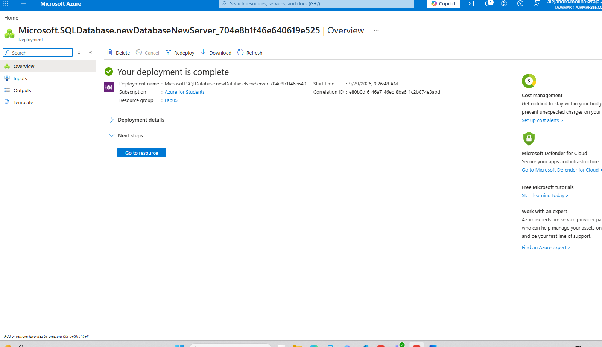
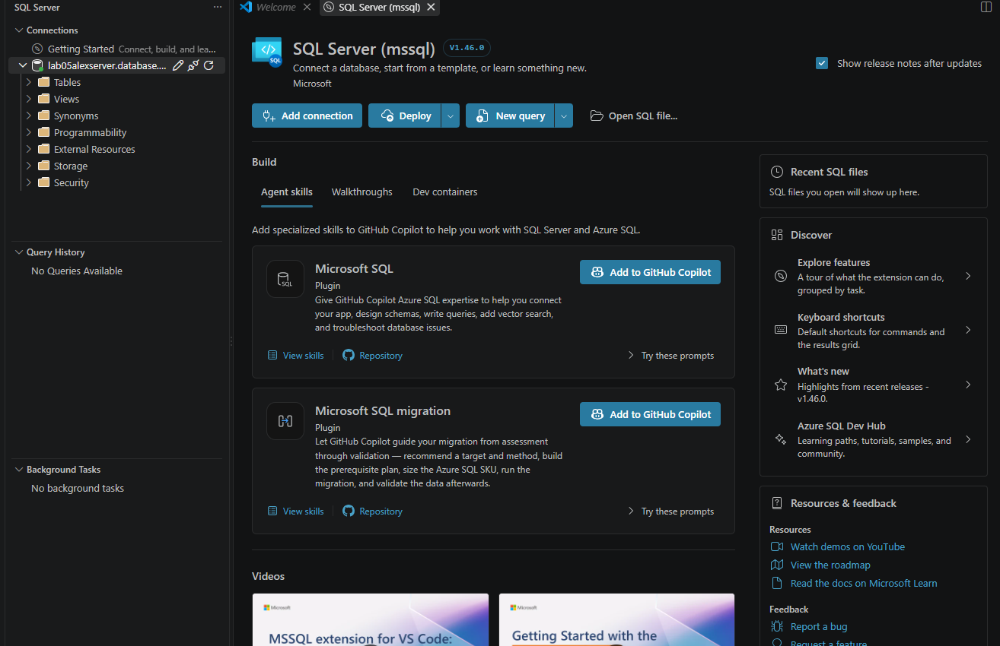
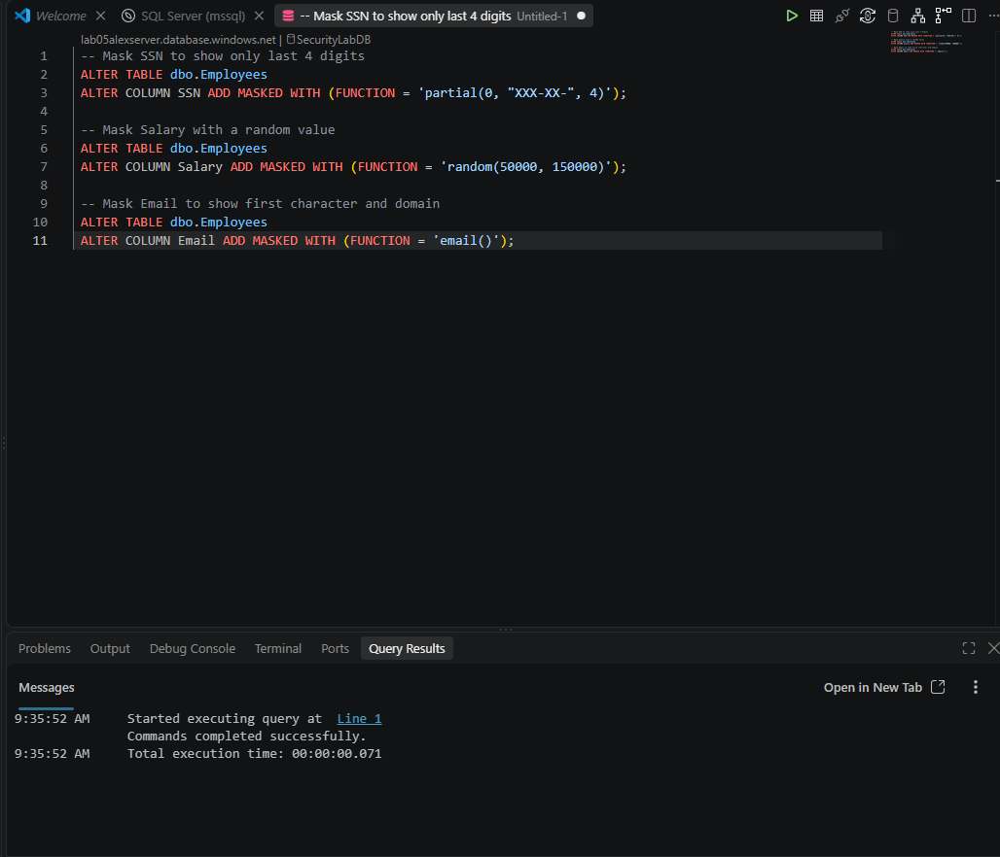
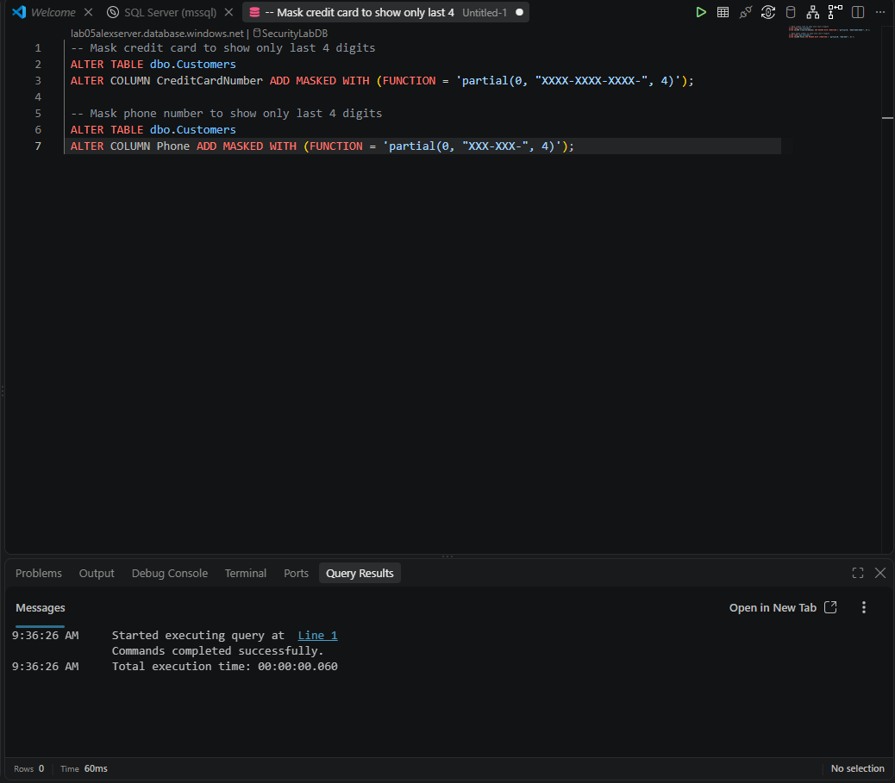
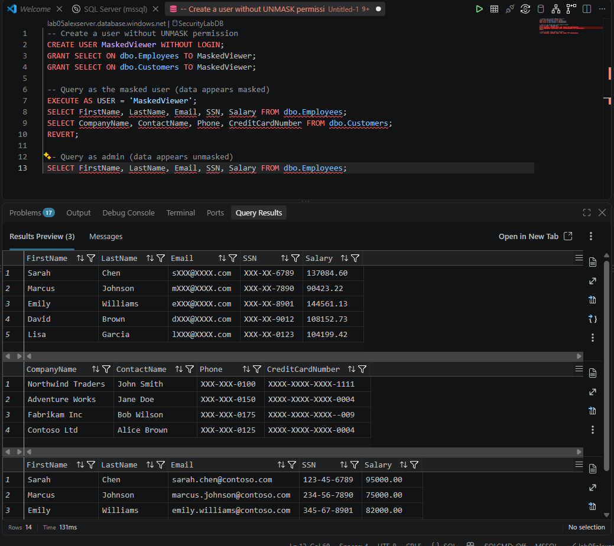
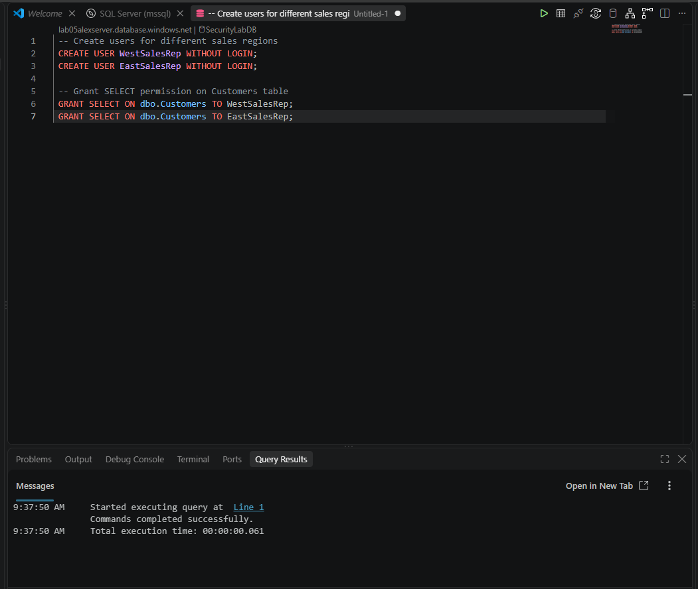
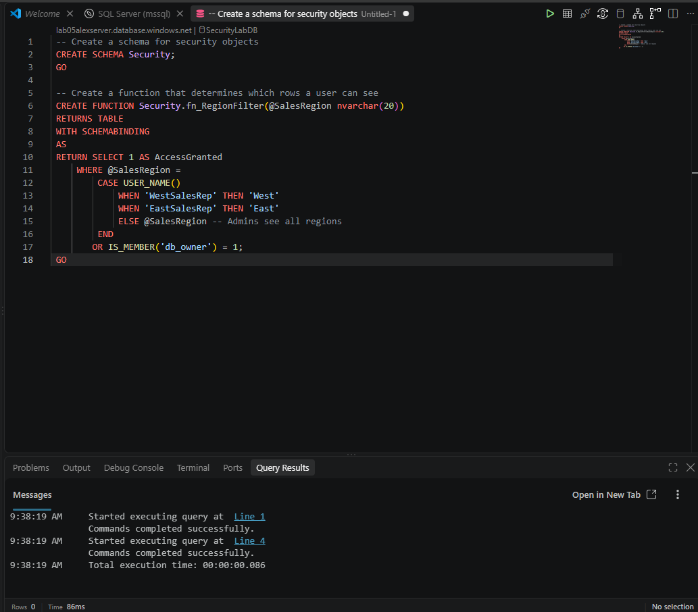
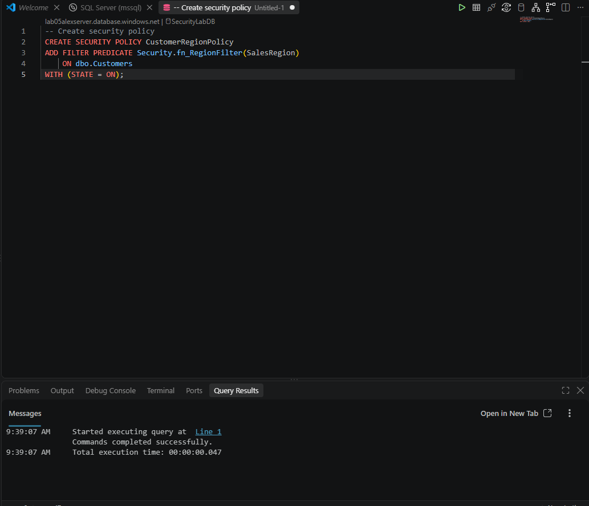
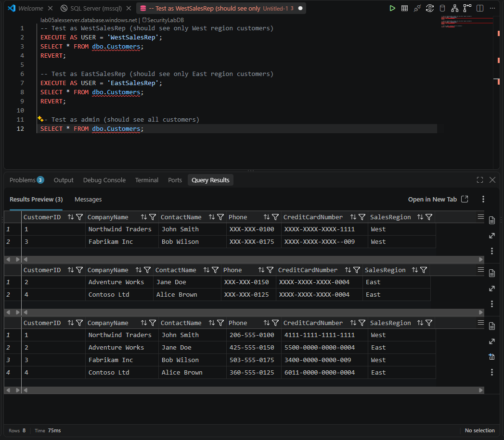

# Laboratorio 05: Implementación de características de seguridad y cumplimiento

En este laboratorio se detalla el proceso para asegurar una base de datos Azure SQL utilizando Enmascaramiento Dinámico de Datos (Dynamic Data Masking - DDM) y Seguridad a Nivel de Fila (Row-Level Security - RLS).

## 1. Aprovisionamiento de la base de datos Azure SQL

El primer paso consiste en desplegar un nuevo servidor y una base de datos en Azure. Una vez configurados los parámetros en el portal y ejecutada la plantilla, verificamos que el despliegue se ha completado correctamente.

## 2. Conexión a la base de datos desde Visual Studio Code

Una vez que la base de datos está disponible, abrimos Visual Studio Code y utilizamos la extensión **SQL Server (mssql)** para establecer la conexión al servidor de Azure recién creado, configurando las reglas de firewall necesarias.

## 3. Preparación del esquema y datos de prueba

Para poder implementar las medidas de seguridad, primero creamos las tablas necesarias (`Employees` y `Customers`) e insertamos algunos datos de muestra.

## 4. Implementación de Enmascaramiento Dinámico de Datos (DDM)

El Enmascaramiento Dinámico de Datos nos permite ocultar información sensible a los usuarios sin privilegios, sin alterar los datos reales en la base de datos.

Primero, aplicamos funciones de enmascaramiento en la tabla de empleados para ocultar parte del Número de Seguro Social (SSN), aleatorizar el salario (Salary) y ocultar parcialmente la dirección de correo electrónico (Email).

A continuación, aplicamos reglas similares en la tabla de clientes para enmascarar el número de tarjeta de crédito y el teléfono.

### Prueba del Enmascaramiento Dinámico de Datos

Para verificar que el DDM funciona, creamos un usuario de prueba llamado `MaskedViewer` (sin permisos de administrador ni de `UNMASK`) y ejecutamos una consulta haciéndonos pasar por él. Comprobamos que el usuario solo ve los datos ofuscados, mientras que un administrador puede seguir viendo los datos reales.

## 5. Implementación de Seguridad a Nivel de Fila (RLS)

La Seguridad a Nivel de Fila nos permite restringir el acceso a los registros de una tabla en función del usuario que ejecuta la consulta. En este escenario, queremos que los representantes de ventas solo vean los clientes de su propia región.

Primero, creamos los usuarios que representarán a los vendedores de la región Este y Oeste, otorgándoles permisos de lectura sobre la tabla de clientes.

Luego, creamos un esquema de seguridad y una función de predicado (`Security.fn_RegionFilter`). Esta función evalúa quién está realizando la consulta y permite el acceso si la región coincide con el nombre del usuario, o si es un administrador.

Finalmente, vinculamos esta función a la tabla `Customers` creando una Política de Seguridad (`CustomerRegionPolicy`).

### Prueba de la Seguridad a Nivel de Fila

Para comprobar que RLS está activo y funcionando, ejecutamos consultas simulando ser `WestSalesRep` y `EastSalesRep`. Como se observa, cada usuario solo recibe las filas correspondientes a su región, mientras que el administrador puede ver todos los registros sin restricciones.

